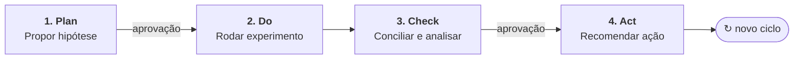

# Copiloto de Margem para Delivery
Copiloto de IA para margem e conciliação de restaurantes no delivery.

Restaurantes que vendem por aplicativos de delivery costumam tomar decisões no escuro: não sabem se receberam o valor certo nos repasses nem se as promoções realmente dão lucro ou só aumentam o volume de pedidos.

Este projeto constrói um copiloto com agentes de IA que ajuda o restaurante a responder duas perguntas:

- **Recebi o que deveria?** Conciliação automática entre pedidos e repasses, com as divergências classificadas por causa.
- **Esta promoção dá lucro?** Experimentos A/B que comparam promoções pela margem, e não só pelo número de pedidos.

**Status:** em construção. Todos os dados usados são fictícios, gerados por código.

## Por que este projeto

Gerenciei o canal de delivery de uma rede de restaurantes e vivi esse problema de perto: conciliação manual, taxas difíceis de acompanhar e promoções avaliadas só pelo volume de vendas. Este projeto aplica dados, estatística e IA a essa dor real.

## Como funciona

Os agentes trabalham em um ciclo PDCA, sempre com uma pessoa aprovando as decisões:

1. **Plan:** um agente propõe hipóteses e desenha experimentos.
2. **Do:** o experimento é aplicado aos dados.
3. **Check:** um agente concilia pedidos e repasses e outro interpreta os resultados com estatística calculada pelo código.
4. **Act:** um agente escreve um resumo executivo com a recomendação.

## Tecnologias

Python · SQL (DuckDB) · pandas · SciPy e statsmodels · agentes de IA com LLMs · Streamlit

## Roteiro

- [x] Preparação do ambiente e estrutura do projeto
- [ ] Definição do problema, KPIs e diagnóstico (Ishikawa)
- [ ] Geração de dados fictícios
- [ ] Conciliação de pedidos e repasses
- [ ] Experimento A/B: desconto × frete grátis
- [ ] Agentes de IA para conciliação e análise
- [ ] Dashboard e resumo executivo

## Autor

**Suami Yonashiro** · Analista de Negócios
[LinkedIn](https://www.linkedin.com/in/suami-yonashiro) · [GitHub](https://github.com/Suami-Yonashiro)