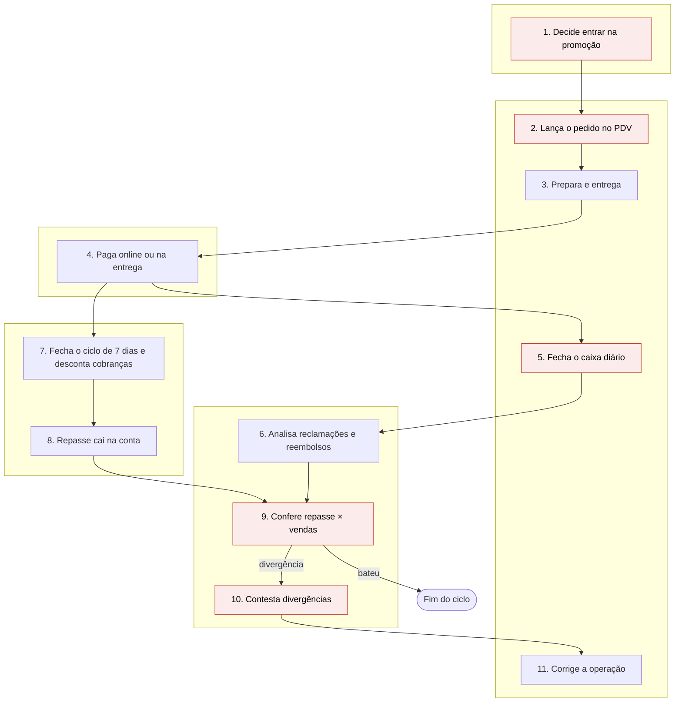

# Conciliação de repasses e decisão de promoções (AS-IS)
**PDD — Documento de Definição de Processo**

**Objetivo do processo:** garantir que o restaurante recebeu o que deveria em cada pedido e decidir quais promoções manter.
**Atores:** dono(a), gerente administrativo(a), gerente de operações e plataforma de delivery.
**Sistemas:** portal da plataforma, gestor de pedidos, PDV, planilha e extrato bancário.

| Nº | Etapa | Quem | Sistema | Frequência | Dor |
|---|---|---|---|---|---|
| 1 | Decide entrar em promoção ou campanha | Dono(a) | Portal da plataforma | Por campanha | Sem projeção da margem nem clareza de quem paga o desconto |
| 2 | Pedido entra pela plataforma e é lançado no PDV | Gerente de operações | Gestor de pedidos + PDV | A cada pedido | Lançamento manual com erros de digitação |
| 3 | Pedido é preparado e entregue | Operação | — | A cada pedido | Volume de promoção pressiona a cozinha |
| 4 | Cliente paga online ou na entrega | Cliente | App ou maquininha | A cada pedido | Meios de pagamento com regras diferentes |
| 5 | Fecha o caixa diário | Gerente de operações | PDV + planilha | Diária | Mistura de meios de pagamento |
| 6 | Analisa reclamações e reembolsos debitados | Operação + administrativo | Portal | Diária | Avaliar se o reembolso procede |
| 7 | Plataforma fecha o ciclo e desconta as cobranças | Plataforma | — | A cada 7 dias | Descontos pouco visíveis por pedido |
| 8 | Repasse cai na conta | Banco | Extrato bancário | Conforme o plano de repasse | Valor líquido difícil de ligar às vendas |
| 9 | Confere repasse × vendas | Gerente administrativo(a) | Extrato + planilha | Conforme o plano de repasse | Manual, cerca de 4 dias intercalados com outras atividades |
| 10 | Contesta divergências | Gerente administrativo(a) | Portal | Após a conferência | Prazo de 7 dias para contestar cancelamento pode já ter passado |
| 11 | Corrige a operação no prazo definido | Gerente de operações | — | Após a contestação | Correção chega tarde |

## Fluxo

