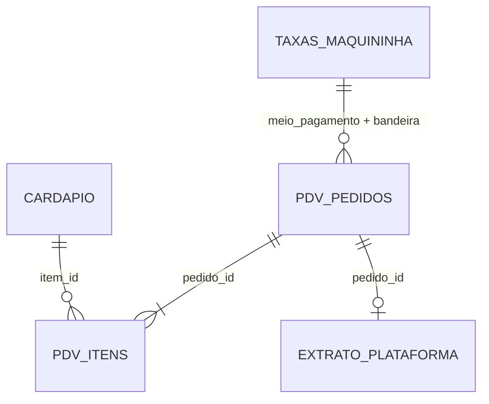

# Dicionário de dados

Todos os dados são fictícios, gerados por `src/gerar_dados.py` com semente fixa: quem rodar o script obtém exatamente os mesmos arquivos. As regras de cobrança da plataforma ficam em `config/plataforma.toml`, lido tanto pelo gerador quanto pelo conciliador.

Período: 01/07/2026 a 30/09/2026 · Plataforma: `plataforma_a` · Plano de repasse: mensal

## Como as tabelas se ligam

O PDV é a fonte do restaurante e não tem erros. O extrato é a versão da plataforma e tem erros plantados. A conciliação compara os dois.

## Arquivos

| Arquivo | Uma linha por | Origem |
|---|---|---|
| `cardapio.csv` | item do cardápio | Restaurante |
| `kit_envio.csv` | item do kit que vai em todo pedido | Restaurante |
| `taxas_maquininha.csv` | meio de pagamento e bandeira | Restaurante |
| `pdv_pedidos.csv` | pedido registrado no PDV | Restaurante |
| `pdv_itens.csv` | item de um pedido | Restaurante |
| `extrato_plataforma.csv` | lançamento da plataforma | Plataforma |
| `gabarito_erros.csv` | erro plantado no extrato | Só para testes |

## cardapio.csv

| Coluna | Descrição |
|---|---|
| item_id | Código do item (P01 a P15) |
| nome | Nome do item |
| categoria | prato, lanche, acompanhamento, sobremesa ou bebida |
| plataforma | Plataforma onde o preço do app vale |
| preco_salao | Preço no salão (R$) |
| preco_app | Preço no app (R$), de 10% a 20% acima do salão, terminado em ,90 |
| cmv | Custo da mercadoria vendida por unidade (R$), já com a embalagem do prato |

## kit_envio.csv

| Coluna | Descrição |
|---|---|
| item | Item do kit (sacola, lacre, talheres, álcool em gel) |
| custo_unitario | Custo de uma unidade (R$) |
| qtd_por_pedido | Quantidade usada em cada pedido |
| custo_por_pedido | custo_unitario × qtd_por_pedido (R$) |

## taxas_maquininha.csv

Usada só nos pedidos pagos na entrega.

| Coluna | Descrição |
|---|---|
| meio | dinheiro, pix, débito, crédito ou vale-refeição |
| bandeira | visa, mastercard, elo, amex ou `-` quando não se aplica |
| taxa | Percentual cobrado sobre o valor pago (0,0177 = 1,77%) |

## pdv_pedidos.csv

| Coluna | Descrição |
|---|---|
| pedido_id | Código do pedido no PDV, em ordem cronológica |
| plataforma | Plataforma de origem do pedido |
| data_hora_pedido | Data e hora do pedido |
| modelo_entrega | `plataforma` (entregador da plataforma) ou `propria` (entregador da loja) |
| forma_pagamento | `online` (pago no app) ou `entrega` (pago ao entregador; só com entrega própria) |
| meio_pagamento | `online` ou o meio usado na entrega |
| bandeira | Bandeira do cartão, ou `-` |
| valor_itens | Soma dos itens (R$) |
| frete_cliente | Frete cobrado do cliente (R$); só existe na entrega própria |
| tipo_promocao | `nenhuma`, `cupom_loja`, `cupom_plataforma` ou `frete_gratis` |
| valor_promocao | Valor da promoção (R$) |
| custeado_por | Quem paga a promoção: `loja`, `plataforma` ou `-` |
| total_cliente | Valor pago pelo cliente (R$) |
| status | `concluido` ou `cancelado` |
| cancelado_por | `cliente`, `loja`, `plataforma` ou `-` |
| data_hora_cancelamento | Data e hora do cancelamento; o prazo de contestação conta a partir dela |
| custo_recuperacao | Brinde ou frete dado ao cliente por erro da operação (R$) |

## pdv_itens.csv

| Coluna | Descrição |
|---|---|
| pedido_id | Pedido ao qual o item pertence |
| item_id | Item do cardápio |
| quantidade | Unidades do item |
| preco_unitario | Preço no app no momento do pedido (R$) |

## extrato_plataforma.csv

| Coluna | Descrição |
|---|---|
| pedido_id | Código do pedido, o mesmo do PDV |
| plataforma | Plataforma que emitiu o extrato |
| data_hora_pedido | Data e hora do pedido |
| data_extrato | Dia em que o lançamento aparece no extrato (dia seguinte ao pedido) |
| status | `concluido` ou `cancelado` |
| data_hora_cancelamento | Data e hora do cancelamento |
| modelo_entrega | `plataforma` ou `propria` |
| forma_pagamento | `online` ou `entrega` |
| valor_itens | Valor dos itens segundo a plataforma (R$) |
| comissao_pct | Percentual de comissão aplicado |
| comissao | Comissão cobrada (R$) |
| taxa_transacao | Taxa sobre pagamento online (R$) |
| promocao_debitada | Promoção descontada da loja (R$) |
| frete_repassado | Frete da entrega própria repassado à loja (R$) |
| taxa_plano | Taxa do plano de repasse (R$); zero no plano mensal |
| irrf | IRRF retido sobre a comissão (R$); imposto antecipado, não entra na margem |
| valor_liquido | Valor que a plataforma vai pagar (R$); negativo nos pedidos pagos na entrega, que só debitam a comissão |
| data_repasse_prevista | Data prevista do pagamento; vazia nos pedidos pagos na entrega |

## gabarito_erros.csv

Lista os erros plantados no extrato. Serve só para medir se o conciliador acerta; o conciliador nunca lê este arquivo.

| Coluna | Descrição |
|---|---|
| pedido_id | Pedido com erro |
| tipo_erro | `REPASSE_AUSENTE`, `COMISSAO_INCORRETA`, `LANCAMENTO_DIVERGENTE`, `PROMOCAO_INDEVIDA` ou `REEMBOLSO_INDEVIDO` |
| valor_esperado | Valor líquido correto pelas regras do config (R$) |
| valor_extrato | Valor líquido que aparece no extrato (R$); vazio quando o pedido não está no extrato |
