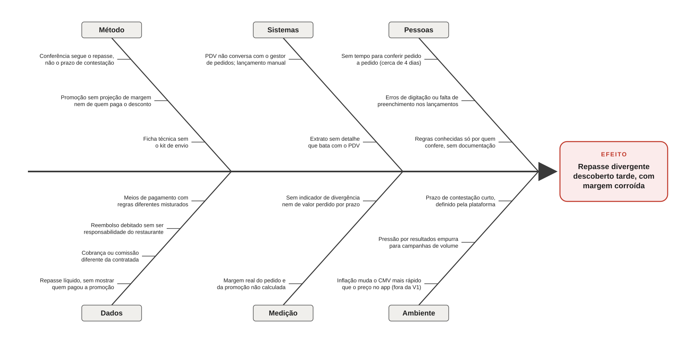

# Ishikawa — causas das divergências e da margem corroída

**Efeito:** repasse divergente descoberto tarde, com margem corroída.

As causas estão organizadas em seis categorias (6M adaptado a serviços) e vêm da vivência na operação de delivery de restaurantes. Causas marcadas como "fora da V1" fazem parte do diagnóstico, mas não são tratadas nesta versão do projeto.

O diagrama é gerado por código. Para mudar uma causa, edite `src/gerar_ishikawa.py` e rode `python src/gerar_ishikawa.py`.

## Das causas ao código

Cada causa tratada pelo projeto vira um erro plantado nos dados fictícios, uma regra do conciliador ou uma análise. Assim, é possível rastrear cada linha de código até a dor que ela resolve.

| Causa | Erro plantado nos dados (Módulo 2) | Como o projeto trata |
|---|---|---|
| Cobrança ou comissão diferente da contratada | Alguns pedidos com comissão acima da contratada | Regra `COMISSAO_INCORRETA` (Módulo 4) |
| Repasse líquido, sem mostrar quem pagou a promoção | Desconto de promoção da plataforma debitado do restaurante | Regra `PROMOCAO_INDEVIDA` (Módulo 4) |
| Reembolso debitado sem ser responsabilidade do restaurante | Reembolso por atraso do entregador da plataforma debitado do restaurante | Regra `REEMBOLSO_INDEVIDO` (Módulo 4) |
| PDV não conversa com o gestor de pedidos; extrato sem detalhe | Pedido online entregue que não aparece no repasse | Regra `REPASSE_AUSENTE` (Módulo 4) |
| Erros de digitação ou falta de preenchimento nos lançamentos | Valor ou meio de pagamento lançado errado, ou campo vazio no PDV | Regra `LANCAMENTO_DIVERGENTE` (Módulo 4) |
| Meios de pagamento com regras diferentes misturados | Pedidos pagos na entrega, que não geram repasse (não é erro) | Exceção que não gera divergência; teste contra falso positivo (Módulo 4) |
| Prazo de contestação curto, definido pela plataforma | Cancelamentos no início do ciclo de repasse | Prazo de contestação por divergência e alerta `PRAZO_PROXIMO` (Módulo 4) |
| Margem real não calculada; ficha técnica sem o kit de envio | — | Cálculo da margem com todas as taxas e o kit de envio (Módulo 3) |
| Promoção sem projeção de margem; pressão por campanhas de volume | — | Teste A/B desconto × frete grátis (Módulo 5) |
| Conferência segue o repasse; sem tempo; sem indicador | — | Conciliação no dia do repasse e painel de KPIs (Módulos 4 e 8) |
| Regras conhecidas só por quem confere | — | Regras de cobrança em arquivo de configuração (Módulo 2) |
| Inflação muda o CMV mais rápido que o preço no app | — | Fora da V1 |
